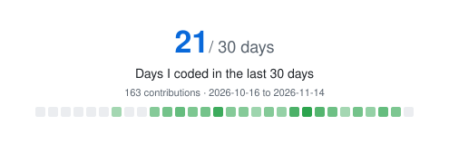

### Md. Khadimul Islam
**Flutter Developer | Mobile Application Engineer | Bangladesh 🇧🇩**

I'm a passionate Mobile Application Developer with **2+ years of experience in Flutter development**, specializing in building scalable, maintainable, and user-friendly cross-platform applications.

Currently working at **TexBazar Ltd**, where I work on developing real-world mobile application features, integrating REST APIs, implementing state management, and building reliable application architectures.

I enjoy transforming ideas into practical software solutions, writing clean and maintainable code, and continuously exploring modern technologies to become a better software engineer.

### 🛠️ Technical Skills

- **Mobile Development:** Flutter, Dart
- **State Management:** Riverpod, Provider, ValueNotifier
- **Architecture:** Clean Architecture, MVVM
- **API Integration:** REST API, Dio, JSON Serialization
- **Local Storage:** Hive
- **Navigation:** GoRouter
- **Programming Fundamentals:** OOP, Data Structures & Algorithms
- **Other Technologies:** Java, Figma, Git, GitHub

### 🚀 Currently

- 🔭 Working as a Flutter Developer at **TexBazar Ltd**
- 🌱 Exploring Go, backend development, and advanced Flutter concepts
- 🏗️ Building scalable applications with clean architecture and modern development practices
- 👯 Open to collaborating on Flutter projects and open-source contributions
- 💬 Ask me about Flutter, Dart, Riverpod, REST API integration, and mobile app architecture
- 📫 Email: **khadimulislam.dev@gmail.com**
- ⚡ Fun fact: I love solving problems and turning ideas into working applications.

### ☕ Support My Work

If you enjoy my work, consider buying me a coffee!

---

**My GitHub activity**

  <picture>
    <source media="(prefers-color-scheme: dark)" srcset="https://raw.githubusercontent.com/md-khadimul-islam/md-khadimul-islam/output/active30-dark.svg" />
    
  </picture>

  <picture>
    <source media="(prefers-color-scheme: dark)" srcset="https://streak-stats.demolab.com?user=md-khadimul-islam&amp;theme=github-dark-blue&amp;hide_border=true&amp;background=0D1117&amp;date_format=M%20j%5B%2C%20Y%5D&timezone=Asia%2FDhaka" />
    
  </picture>
  <picture>
    <source media="(prefers-color-scheme: dark)" srcset="https://github-stats-extended.vercel.app/api/top-langs/?username=md-khadimul-islam&amp;layout=compact&amp;langs_count=6&amp;theme=github_dark&amp;hide_border=true&amp;bg_color=0D1117&amp;card_width=320&amp;cache_seconds=86400" />
    
  </picture>

---

  Build with purpose. Keep learning. Stay curious. 🚀

