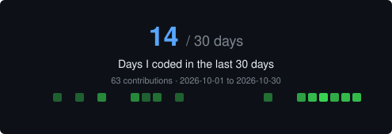

### Hi there 👋, I'm Khadimul Islam
I'm Khadimul. If you're looking for a designer to create your unique, stunning, professional,  Flutter Mobile Application Developer from Bangladesh. I am an experienced UI/UX Designer with 1 years of experience. I am a Mobile App developer, Proficient in Dart & Flutter in crafting user-friendly and innovative mobile applications. Committed to delivering high-quality, efficient, and scalable solutions to enhance user experiences. Seeking opportunities to collaborate on exciting projects and further expand my skills in the dynamic world of mobile app development.

Skills: Figma / Dart/ Java/ Data Structure Algorithm/ OOP/ Flutter

- 🔭 I’m currently working on TexBazar Ltd
- 🌱 I’m currently learning Dart & Flutter 
- 👯 I’m looking to collaborate on GitHub 
- 💬 Ask me about Dart & Flutter 
- 📫 How to reach me: khadimulislam.dev@gmail.com 
- ⚡ Fun fact: I love to write code 

### ☕ Support My Work

If you enjoy my work, consider buying me a coffee!

My GitHub activity

 

  

<table> <tr> <td align="center" valign="middle">  </td> <td align="center" valign="middle">  </td> </tr> </table> 
 

  Build with purpose. Keep learning. Stay curious. 🚀

